# Coffie Mood

**Your Mood. Your Coffee. Your Moment.**

Coffie Mood is a multi-tenant SaaS platform that any coffee shop can use. A customer scans the café's QR code and, with permission, looks at the camera. Coffie Mood estimates their visible facial expression in the browser and recommends a drink from that café's own menu. The customer always confirms or corrects the mood before getting a recommendation.

**Core experience:** Detect. Understand. Recommend. Enjoy.

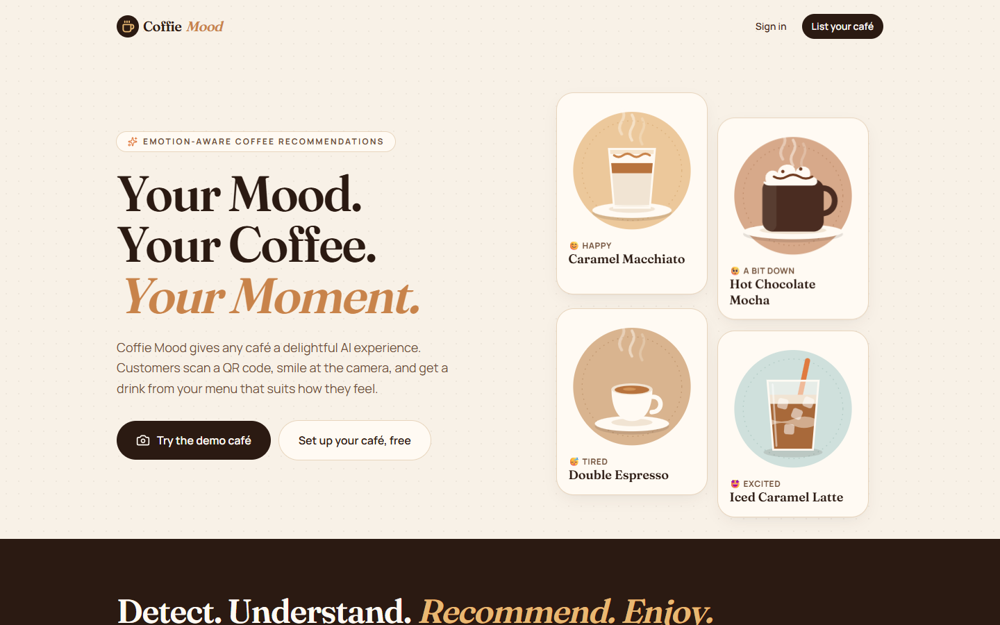

## Contents

- [Screenshots](#screenshots)
- [What's included](#whats-included)
- [System architecture](#system-architecture)
- [Quick start](#quick-start-demo-mode)
- [Connect Supabase](#connect-supabase)
- [Deploy](#deploy)
- [How mood estimation works](#how-mood-estimation-works)
- [Security model](#security-model)
- [Known limitations](#known-limitations)

## Screenshots

### Customer journey

| 1. Welcome | 2. Camera consent |
|---|---|
| 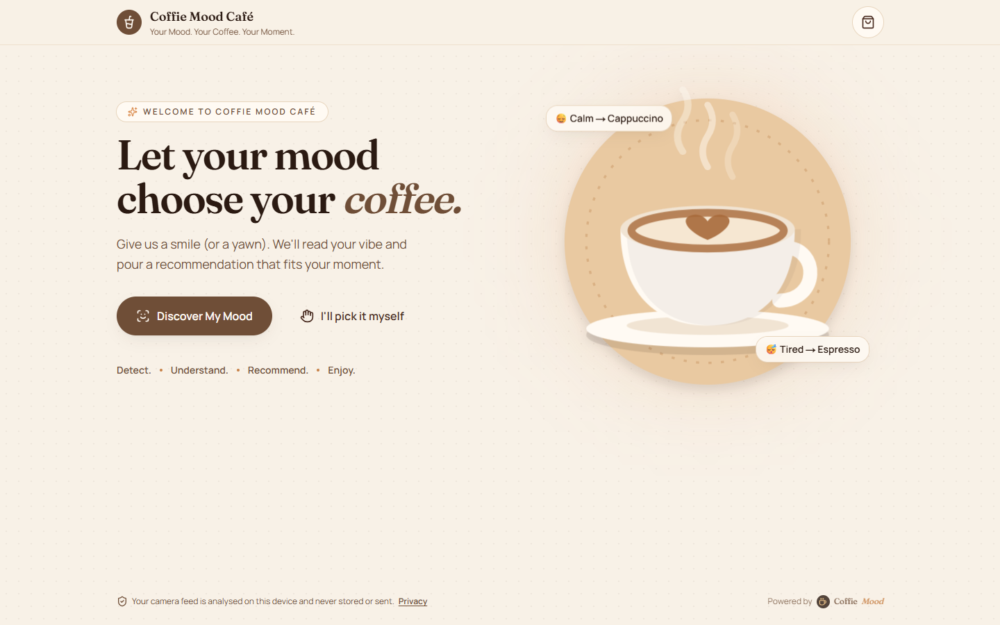 | 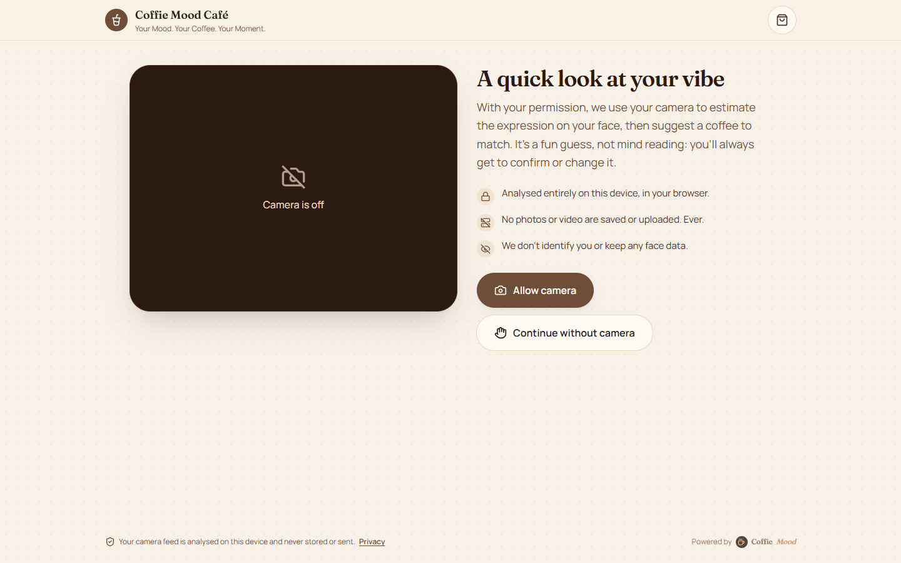 |
| **3. Pick or confirm a mood** | **4. Recommendation** |
| 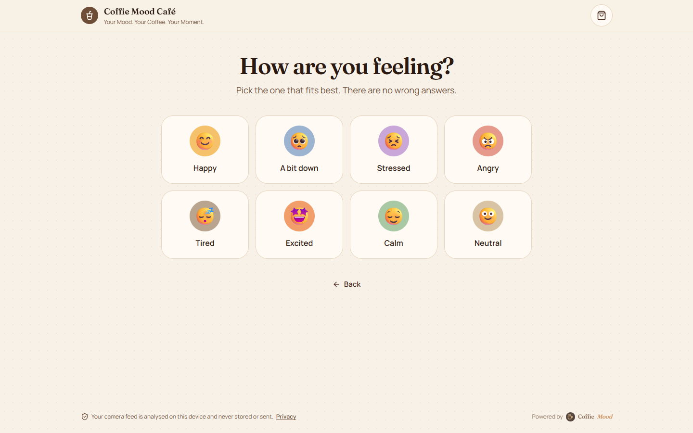 | 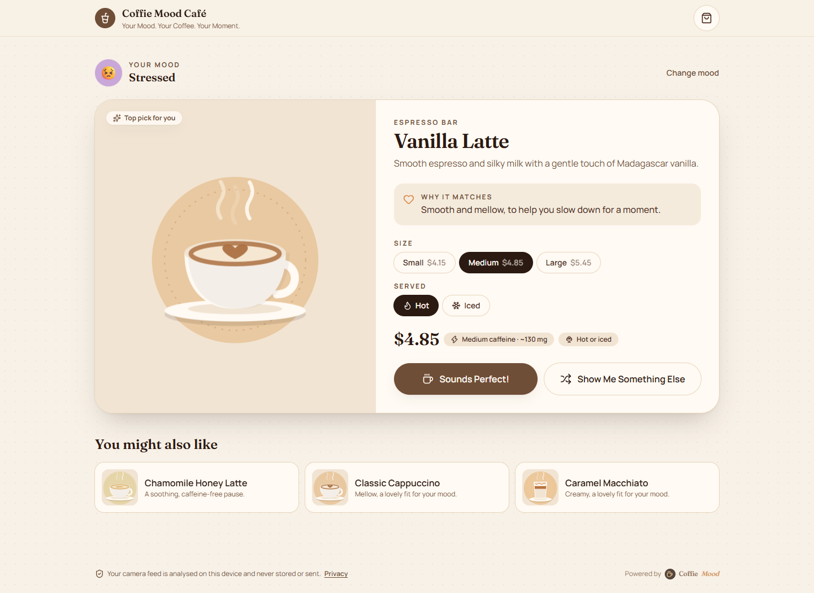 |
| **5. Personalised result** | **6. Cart and ordering** |
| 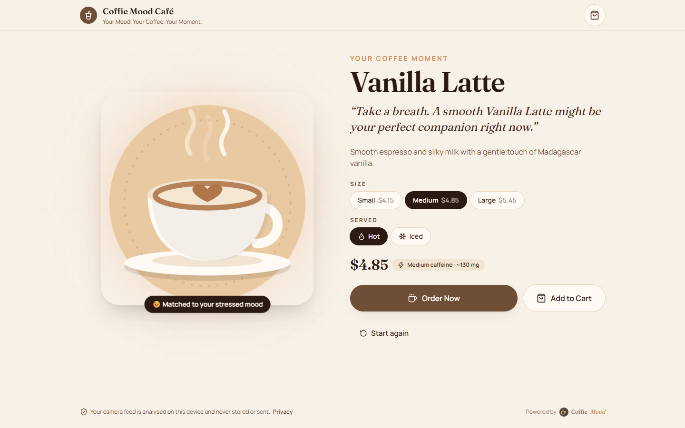 | 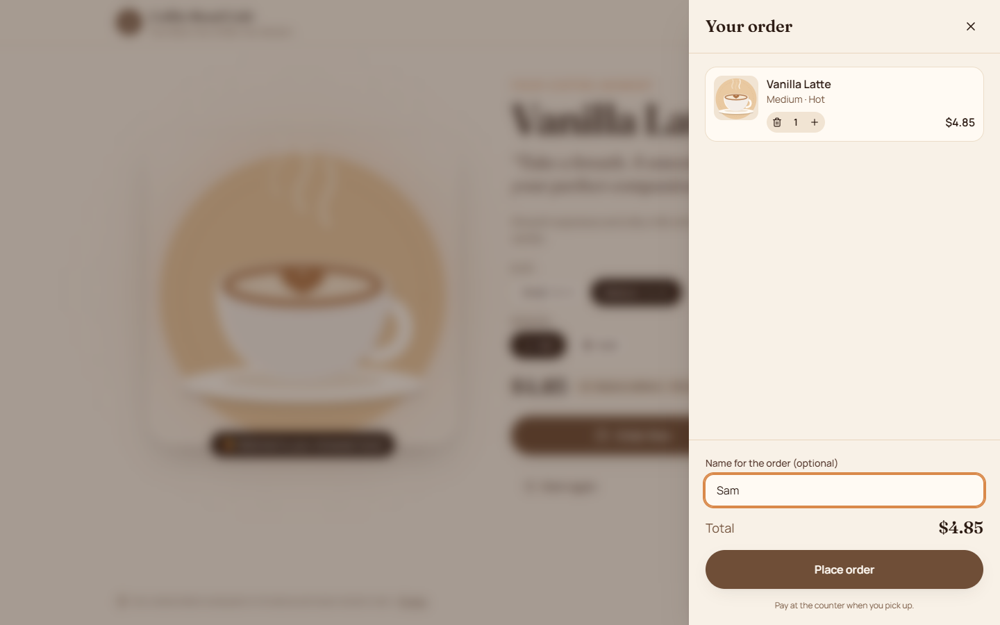 |

### Mobile-first

| Welcome | Recommendation | Order placed |
|---|---|---|
| 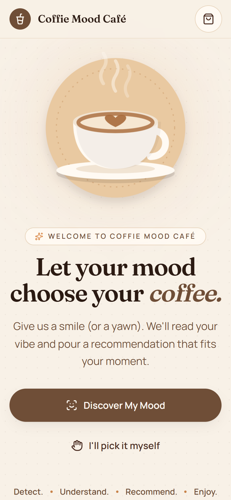 | 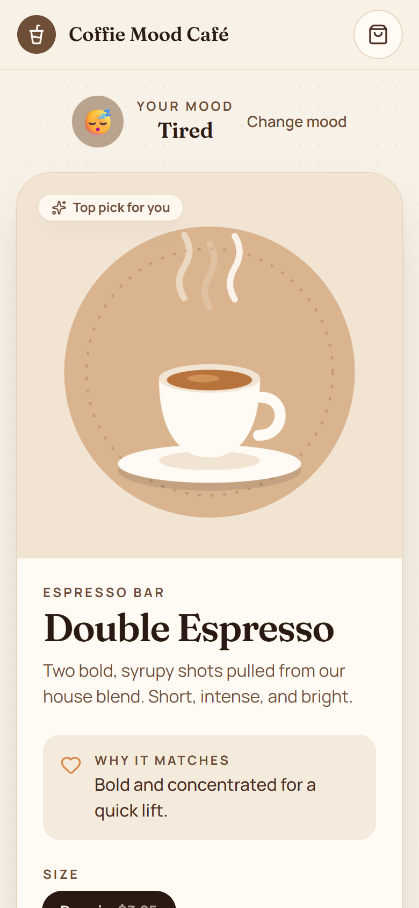 | 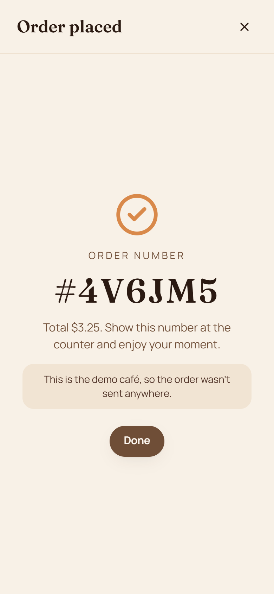 |

### Café owners and privacy

| Café sign-up | Privacy page |
|---|---|
| 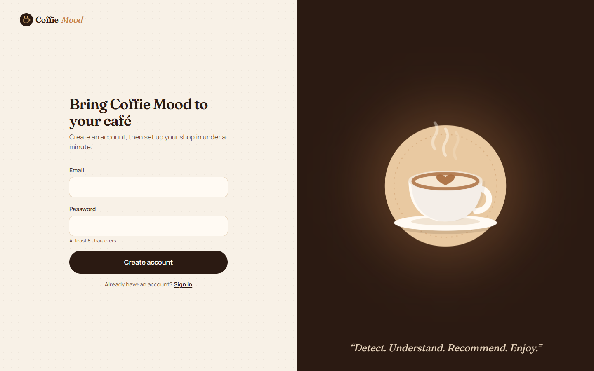 | 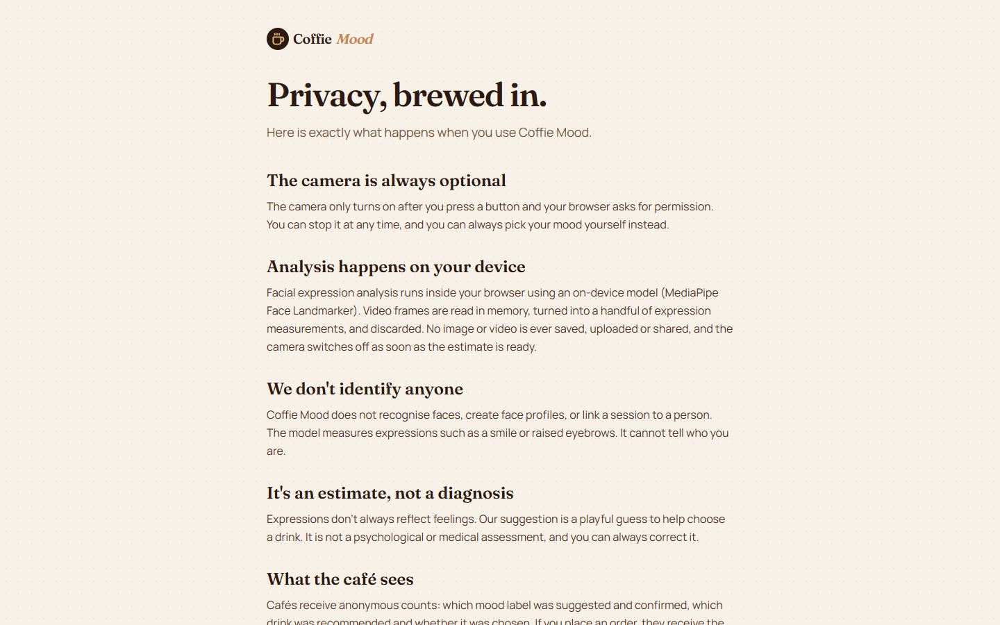 |

These screenshots come from the built-in demo café at `/shop/demo`. The café dashboard needs a connected Supabase project, so it isn't pictured yet.

## What's included

| Area | What it does |
|---|---|
| Customer experience (`/shop/[slug]`) | Welcome, camera consent, live preview, on-device analysis, mood confirmation, manual mood picker, recommendation with sizes, hot/iced, price, caffeine and alternatives, result screen, cart and ordering. |
| Expression model | MediaPipe Face Landmarker (blendshapes) running in the browser. The model and WASM runtime are served from this app, so no frames or requests go to third parties. |
| Recommendation engine | Shop-configured rules per mood first, then tag matching, then the rest of the menu, so "Show me something else" never dead-ends. |
| Café dashboard (`/dashboard`) | Analytics overview, live orders board, menu management with image upload, mood rules with live preview, branding, QR code, public URL, team roles. |
| Multi-tenancy | Every row carries `shop_id`. Postgres Row Level Security and column grants isolate tenants and enforce owner, manager and staff roles. |
| Demo mode | `/shop/demo` works with no database, using a built-in menu. |

Supported moods: happy, sad, stressed, angry, tired, excited, calm and neutral.

## System architecture

### Overview

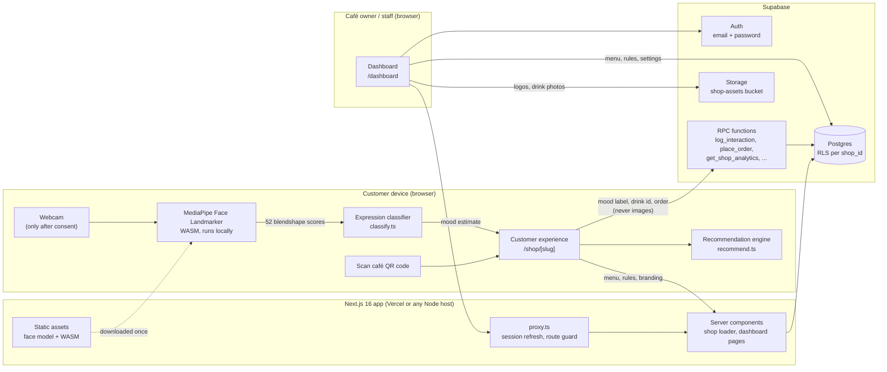

### Customer journey

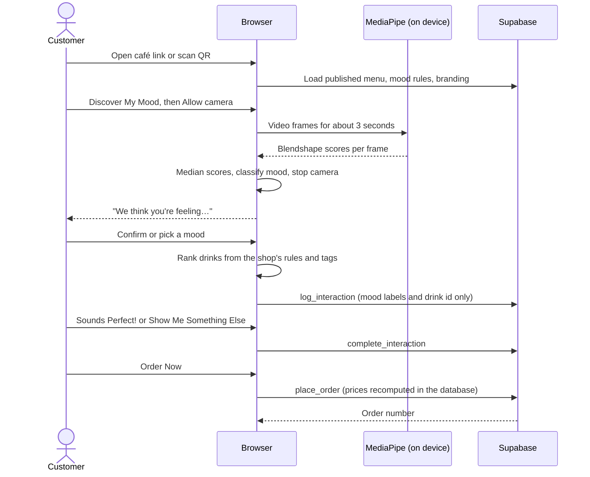

### Data model

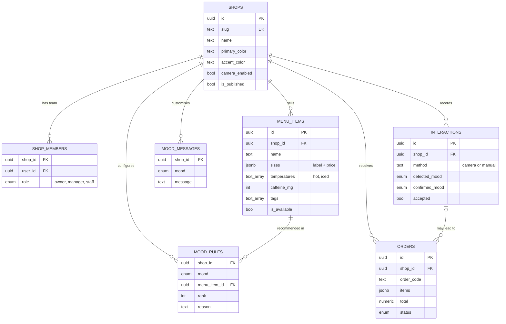

### Source layout

```
src/
  app/
    page.tsx                 Platform landing page
    shop/[slug]/             Public customer experience (one per café)
    dashboard/(app)/         Overview, orders, menu, moods, settings
    dashboard/new/           Café onboarding
    login, signup, auth/     Supabase email + password auth
  components/experience/     Customer journey steps, cart
  components/dashboard/      Dashboard UI
  lib/expression/            Blendshape classifier + camera/MediaPipe hook
  lib/recommend.ts           Recommendation engine
  lib/data/                  Server data loaders, demo café
  proxy.ts                   Session refresh and /dashboard protection
supabase/migrations/         Schema, RLS, RPC functions, storage policies
docs/screenshots/            README images
```

### Technology stack

| Layer | Technology |
|---|---|
| Frontend | Next.js 16 (App Router), TypeScript, Tailwind CSS 4, Framer Motion, Lucide icons |
| AI | MediaPipe Tasks Vision Face Landmarker, client-side inference |
| Backend | Next.js server components and route handlers, Supabase RPC functions |
| Database | PostgreSQL on Supabase with Row Level Security |
| Auth and storage | Supabase Auth, Supabase Storage |
| Testing | Vitest unit tests |

## Quick start (demo mode)

```bash
npm install        # also copies the MediaPipe WASM runtime into public/mediapipe
npm run dev
```

Open http://localhost:3000/shop/demo. Camera access needs `localhost` or HTTPS.

## Connect Supabase

1. Create a project at [supabase.com](https://supabase.com).
2. Apply the schema. Either paste `supabase/migrations/20261117000000_init.sql` into the SQL editor, or use the CLI:
   ```bash
   npx supabase link --project-ref YOUR-PROJECT-REF
   npx supabase db push
   ```
   Optionally run `supabase/seed.sql` to create three sample cafés (`coffee-house`, `mocha-cafe`, `urban-brews`).
3. Copy `.env.example` to `.env.local` and fill in the project URL and publishable (or anon) key.
4. In **Authentication → URL Configuration**, set the Site URL to your domain and add `https://YOUR-DOMAIN/auth/callback` (and `http://localhost:3000/auth/callback`) to the redirect allow list.
5. Restart `npm run dev`, then sign up at `/signup`. You'll be asked to create your café, optionally pre-filled with a nine-drink starter menu and mood rules.

The migration also creates the public `shop-assets` storage bucket for logos and menu photos. Only PNG, JPEG and WebP up to 5 MB are accepted, and only owners and managers can write into their shop's folder.

## Deploy

The app is a standard Next.js 16 project and deploys to Vercel or any Node host.

```bash
npm i -g vercel
vercel                      # link and create a preview deployment
vercel env add NEXT_PUBLIC_SUPABASE_URL
vercel env add NEXT_PUBLIC_SUPABASE_PUBLISHABLE_KEY
vercel env add NEXT_PUBLIC_SITE_URL
vercel --prod
```

`NEXT_PUBLIC_*` values are inlined at build time, so redeploy after changing them.

## Scripts

| Command | Purpose |
|---|---|
| `npm run dev` | Development server |
| `npm run build` / `npm start` | Production build and server |
| `npm test` | Unit tests for the expression classifier and recommendation engine |
| `npm run typecheck` / `npm run lint` | Static checks |

On Windows, run tests from a shell whose working directory uses an uppercase drive letter (`E:\...`). Vitest can load twice when the same path appears as both `e:` and `E:`.

## How mood estimation works

1. Nothing happens until the customer presses **Allow camera** and the browser grants permission.
2. For about three seconds, each video frame goes through MediaPipe Face Landmarker, which outputs 52 facial "blendshape" scores such as smile, brow raise and eye openness.
3. The median of each score across frames filters out blinks and twitches. A transparent rule set in `src/lib/expression/classify.ts` maps the scores to happy, sad, stressed, angry, tired, excited, calm or neutral.
4. The camera stops as soon as the estimate is ready. Frames are never drawn to a canvas, stored or uploaded.
5. The customer sees "We think you're feeling…" and confirms or chooses their own mood.

The scores are relative evidence, not calibrated probabilities. That is why the UI never shows a confidence percentage. Facial expressions don't reliably reveal emotions, and the product copy is written to reflect that.

## Security model

- **Reads:** anyone can read published shops, their available menu items, mood rules and messages. Members can read everything for their own shops.
- **Writes:** owners and managers edit menus, rules and settings. Staff can view stats and move orders through their statuses. Column grants stop staff from changing order totals or items.
- **Anonymous customer events** go only through validated `SECURITY DEFINER` functions: `log_interaction`, `complete_interaction` and `place_order`. `place_order` recomputes every price from the database and ignores client-sent prices.
- **Cross-tenant references** are blocked by composite foreign keys. For example, a mood rule cannot point at another shop's drink.

## Making the recommendation mapping your own

Each café sets its rules under **Dashboard → Mood rules**. A mood can have up to 12 ranked drinks, each with a "why it matches" reason, plus a custom message using `{coffee}` as a placeholder. Drinks without a rule are still suggested through their tags, such as `comforting`, `energizing` or `soothing`. The defaults live in `src/lib/moods.ts`.

## Known limitations

- The expression rules are hand-tuned against MediaPipe's blendshape definitions and covered by unit tests. They have not been validated on a labelled dataset of real faces. Tune the thresholds in `classify.ts` with your own testing.
- Ordering is pay-at-counter. No payment provider is integrated.
- The orders board refreshes every 20 seconds rather than using Supabase Realtime.
